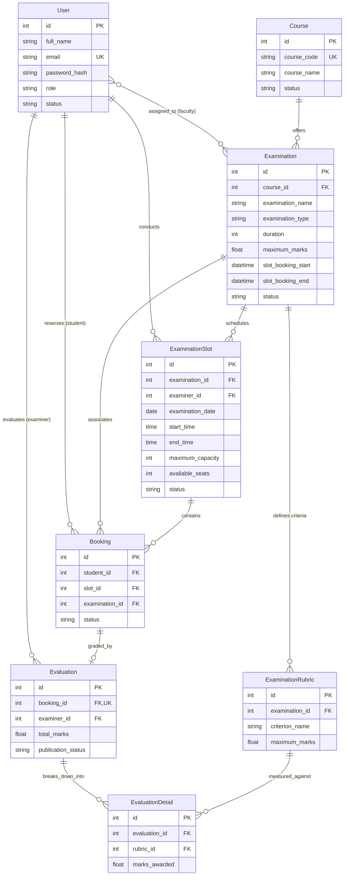

# ACADEMIC PROJECT REPORT
## EXAMINATION MANAGEMENT PORTAL (EMP)

---

### 1. Student & Project Identification
- **Student Name:** Tirth Bora
- **Email Address:** tirthbora8806@gmail.com
- **Degree Program:** BS in Data Science & Applications / Diploma in Programming
- **Institution:** Indian Institute of Technology Madras (IIT Madras)
- **Course / Module:** Tools in Data Science / Application Development Practice
- **Project Title:** Examination Management Portal (EMP)
- **Repository URL:** https://github.com/TirthBora/examination-management-portal
- **Submission Date:** 15 November 2026
- **Demonstration Video Link:** `[Google Drive / YouTube Video Link Placeholder - Enter URL Here]`

---

### 2. Problem Statement & Context
Academic assessment in tertiary institutions necessitates the orderly scheduling, conduction, and evaluation of viva-voce examinations, laboratory practicals, and project demonstrations. Traditionally, departmental offices coordinate these activities through decentralized spreadsheets, manual email correspondence, and ad-hoc booking forms. 

This manual paradigm manifests severe operational bottlenecks:
1. **Scheduling Conflicts & Overbooking:** Examiners inadvertently double-book time slots; multiple students register for slots with exhausted capacity.
2. **Timeline Desynchronization:** Students attempt to book slots before faculty have finalized availability, or examiners modify slots after candidates have scheduled attendance.
3. **Non-Standardized Evaluation:** Marks are recorded on loose paper sheets without criterion-specific rubrics, impeding transparent and consistent scoring.
4. **Lack of Auditability:** Cancellations and reallocations leave no auditable historical footprints, obscuring institutional accountability.

The **Examination Management Portal (EMP)** resolves these deficiencies by establishing a single source of truth across Administrators, Faculty Examiners, and Students.

---

### 3. Development Approach & Architectural Design

The EMP system is architected as a modular, three-tier model-view-controller web application strictly adhering to Python and Flask standards.

```
+---------------------------------------------------------------------------------+
|                               PRESENTATION TIER                                 |
|      Jinja2 Template Inheritance  |  Bootstrap 5.3  |  Bootstrap Icons          |
+---------------------------------------------------------------------------------+
                                       |
                                HTTP Requests / Session Cookies
                                       v
+---------------------------------------------------------------------------------+
|                               CONTROLLER TIER                                   |
|   auth_bp       |   admin_bp        |   examiner_bp     |   student_bp          |
|  (Authentication) (System Control)  (Slot & Grading)    (Catalog & Booking)     |
+---------------------------------------------------------------------------------+
                                       |
                                Service Delegations
                                       v
+---------------------------------------------------------------------------------+
|                                BUSINESS LOGIC TIER                              |
|   BookingService          |    ExaminationService    |   EvaluationService      |
|  - Concurrency Lock       |   - Timeline Enforcer    |  - Rubric Ceiling Check  |
|  - Duplicate Guard        |   - Auto State Machine   |  - Publication Gate      |
|  - Capacity Restoration   |   - Allocation Manager   |  - Detail Aggregator     |
+---------------------------------------------------------------------------------+
                                       |
                                SQLAlchemy ORM
                                       v
+---------------------------------------------------------------------------------+
|                                 DATABASE TIER                                   |
|                SQLite 3 (ACID Compliant Local Relational Storage)               |
|      Users | Courses | Examinations | Rubrics | Slots | Bookings | Evaluations  |
+---------------------------------------------------------------------------------+
```

#### Key Design Decisions:
- **Application Factory Pattern (`app.create_app`):** Isolates configuration environments (`development`, `testing`, `production`) and facilitates in-memory test isolation.
- **Service Layer Separation:** Business rules (such as capacity calculation, slot conflict checks, and duplicate booking prevention) are decoupled from Flask route controllers into dedicated services (`app/services/`), ensuring high testability and clean code organization.
- **Database-Level Integrity Constraints:** Critical rules (e.g., single active booking per examination per student) are enforced both in Python code and via an SQLite partial unique index (`uq_active_student_exam_booking`).

---

### 4. Frameworks, Libraries & Technology Stack

In strict accordance with the mandatory project statement, all modern single-page-app frameworks (React, Next.js, Angular, Vue) and external database engines (PostgreSQL, MySQL, MongoDB) were prohibited:

| Technology | Version / Spec | Technical Justification |
|---|---|---|
| **Python** | 3.13.x | Core execution environment; robust standard libraries and typing support. |
| **Flask** | 3.0.3 | Lightweight, standards-compliant WSGI microframework offering clean request dispatching. |
| **SQLite 3** | Standard | Zero-configuration, serverless, self-contained relational storage providing full ACID transactions. |
| **Flask-SQLAlchemy** | 3.1.1 | Pythonic ORM abstraction supporting foreign key relationships, cascade deletes, and partial unique indexes. |
| **Flask-Login** | 0.6.3 | Secure user session management, remember-me cookies, and `user_loader` authentication pipeline. |
| **Werkzeug** | 3.0.6 | Industrial-strength PBKDF2-SHA256 password hashing and secure request utilities. |
| **Bootstrap** | 5.3.3 | Responsive mobile-first CSS grid, clean academic typography, cards, and accessible forms. |
| **Pytest** | 9.2.0 | Automated testing framework with fixtures and in-memory test databases. |

---

### 5. Entity-Relationship (ER) Schema



---

### 6. Controller Route Catalog & API Endpoints

| Blueprint | Endpoint URL | Method | Access Role | Description |
|---|---|---|---|---|
| **Root** | `/` | GET | Public | Dynamic dispatch to user dashboard or login screen |
| **Auth** | `/auth/login` | GET, POST | Public | User authentication with PBKDF2 credential verification |
| **Auth** | `/auth/register/student` | GET, POST | Public | Student self-registration (instantly active) |
| **Auth** | `/auth/register/examiner`| GET, POST | Public | Faculty examiner application (pending admin review) |
| **Auth** | `/auth/logout` | GET | Authenticated | Clears user session and terminates login state |
| **Admin** | `/admin/dashboard` | GET | Admin | System statistics, pending approvals, recent bookings |
| **Admin** | `/admin/courses` | GET, POST | Admin | Academic course catalog management (CRUD) |
| **Admin** | `/admin/examinations` | GET, POST | Admin | Examination creation, timeline definitions, status update |
| **Admin** | `/admin/examinations/<id>` | GET | Admin | Details, rubric builder, and examiner assignment |
| **Admin** | `/admin/examiners` | GET, POST | Admin | Verification, approval, and deactivation of faculty |
| **Admin** | `/admin/students` | GET, POST | Admin | Student directory inspection and account status toggling |
| **Admin** | `/admin/bookings` | GET | Admin | Search bookings by student/examiner/exam ID or name |
| **Admin** | `/admin/bookings/<id>/reschedule` | GET, POST | Admin | Atomically moves student to another slot in same exam |
| **Admin** | `/admin/slots/<id>/reassign` | POST | Admin | Reallocates slot examiner with schedule conflict validation |
| **Examiner** | `/examiner/dashboard` | GET | Examiner | Examiner metrics, assigned modules, grading queue |
| **Examiner** | `/examiner/examinations/<int:exam_id>/slots/new` | GET, POST | Examiner | Authors slot with date, time, capacity (within window) |
| **Examiner** | `/examiner/slots/<int:slot_id>/edit` | GET, POST | Examiner | Updates slot before booking window with capacity & overlap checks |
| **Examiner** | `/examiner/slots/<id>/students` | GET | Examiner | Inspects booked candidates and contact details |
| **Examiner** | `/examiner/bookings/<id>/evaluate` | GET, POST | Examiner | Multi-criteria rubric evaluation and mark publication |
| **Student** | `/student/dashboard` | GET | Student | Upcoming examination schedule, open tests, score summaries |
| **Student** | `/student/examinations` | GET | Student | Course & type filtered examination browser |
| **Student** | `/student/slots/<id>/book` | POST | Student | Reserves seat with concurrency locking & duplicate check |
| **Student** | `/student/bookings/<id>/cancel` | POST | Student | Cancels booking and restores slot capacity |
| **Student** | `/student/results/<id>` | GET | Student | Verified printable academic scorecard |

---

### 7. Critical Business Logic Implementation

1. **Transactional Slot Capacity Enforcement & SQLite Concurrency:**  
   Concurrency control in SQLite is enforced through transactional serialization (`BEGIN IMMEDIATE` write transactions) combined with database-level atomic conditional updates (`available_seats = available_seats - 1 WHERE id = :id AND available_seats > 0`) and SQLite partial unique indexing (`uq_active_student_exam_booking`). When capacity reaches zero, the slot automatically transitions to `'Full'`. Overbooking and duplicate registrations are impossible under simultaneous requests.
2. **Duplicate Active Booking Elimination:**  
   Students cannot book multiple slots for the same examination. This is validated at the service layer and guarded at the database level using a partial unique index on `(student_id, examination_id) WHERE status = 'Booked'`.
3. **Capacity Restoration with Audit History:**  
   When a student cancels before the configured booking deadline, the booking status transitions to `'Cancelled'` (preserving institutional audit history), and the associated slot's `available_seats` is incremented.
4. **Timeline Synchronization Engine:**  
   Examiners can author and update slots strictly while `slot_creation_start <= now <= slot_creation_end` and prior to `slot_booking_start`. Students can book only while `slot_booking_start <= now <= slot_booking_end`. Cancellation is rejected once the booking window deadline has arrived (`now >= slot_booking_end`).
5. **Examiner Reassignment with Schedule Overlap Prevention:**  
   Administrators can reallocate slots to different approved examiners; the system strictly validates that the recipient faculty member has no overlapping commitments on that date and time before completing the reassignment.
6. **Mandatory Rubric Completeness:**  
   `EvaluationService.submit_evaluation` requires marks for every single configured rubric criterion associated with the examination. Evaluations with omitted or partial criteria are rejected. Total marks cannot exceed the examination ceiling.
7. **Cross-Site Request Forgery (CSRF) Defense:**  
   State-changing POST, PUT, and DELETE operations across all user roles require a cryptographically verified CSRF token generated via `secrets.token_hex(32)` and validated using constant-time string comparison (`hmac.compare_digest`). Debug mode is disabled by default.

---

### 8. Quality Assurance & Pytest Verification

A test suite containing **26 automated test cases** was implemented in `tests/` using `pytest`. All tests execute against an in-memory SQLite database utilizing SQLAlchemy's `StaticPool` for concurrency isolation within the project virtual environment (`pip install -r requirements.txt`).

```
================================ test session starts =================================
platform win32 -- Python 3.13.12, pytest-9.2.0, pluggy-1.7.0
rootdir: D:\Dev_Projects\IITM Tools in DS\examination-management-portal
collected 26 items

tests/test_admin.py::test_course_crud PASSED                                   [  4%]
tests/test_admin.py::test_examination_management PASSED                        [  8%]
tests/test_admin.py::test_rubric_management PASSED                             [ 12%]
tests/test_admin.py::test_examiner_deactivation_and_reassignment PASSED        [ 15%]
tests/test_admin.py::test_examiner_reassignment_conflict_prevention PASSED     [ 19%]
tests/test_auth.py::test_admin_login PASSED                                    [ 23%]
tests/test_auth.py::test_student_registration_and_login PASSED                 [ 27%]
tests/test_auth.py::test_examiner_registration_and_pending_approval PASSED       [ 31%]
tests/test_auth.py::test_examiner_approval_workflow PASSED                     [ 35%]
tests/test_auth.py::test_role_based_access_restrictions PASSED                 [ 38%]
tests/test_auth.py::test_csrf_token_validation PASSED                          [ 42%]
tests/test_booking.py::test_overbooking_prevention PASSED                      [ 46%]
tests/test_booking.py::test_duplicate_booking_prevention PASSED                [ 50%]
tests/test_booking.py::test_booking_deadline_enforcement PASSED                [ 54%]
tests/test_booking.py::test_slot_creation_deadline_enforcement PASSED          [ 58%]
tests/test_booking.py::test_admin_rescheduling PASSED                          [ 62%]
tests/test_booking.py::test_cancellation_deadline_boundary_enforcement PASSED [ 65%]
tests/test_examiner.py::test_slot_creation_and_conflict_detection PASSED       [ 69%]
tests/test_examiner.py::test_rubric_evaluation_submission PASSED               [ 73%]
tests/test_examiner.py::test_unauthorized_examiner_evaluation_guard PASSED       [ 77%]
tests/test_examiner.py::test_examiner_edit_slot_before_booking PASSED         [ 81%]
tests/test_examiner.py::test_slot_editing_creation_window_enforcement PASSED  [ 85%]
tests/test_examiner.py::test_evaluation_incomplete_rubric_rejection PASSED    [ 88%]
tests/test_student.py::test_student_browse_and_book_slot PASSED                [ 92%]
tests/test_student.py::test_student_booking_cancellation PASSED                [ 96%]
tests/test_student.py::test_result_publication_visibility PASSED               [100%]

============================= 26 passed in 21.02s =============================
```

---

### 9. AI / LLM Assistance Declaration

In compliance with IIT Madras academic integrity guidelines, the following tools were utilized during the conception and realization of this portal:
- **Tool:** Google Antigravity (Advanced Agentic Coding Environment) powered by Gemini.
- **Nature of Assistance:** Pair programming, initial scaffolding of modular Flask structure, drafting Bootstrap 5 CSS layouts, and formulating pytest boundary test cases.
- **Student Ownership:** Architecture design, database constraint formulation, debugging of SQLite concurrency behaviors, verification of business rules, and validation of all code deliverables were directed and reviewed by the student.

---

### 10. Conclusion & Future Enhancements

The Examination Management Portal successfully fulfills all requirements outlined in the official IIT Madras specification. It replaces manual scheduling workflows with an automated, synchronized, and auditable web portal.

**Planned Post-Submission Extensions:**
- Automated SMTP email notifications for booking confirmations and published scorecards.
- PDF scorecard export utilizing WeasyPrint or ReportLab.
- Graphical cohort analytics and marks distribution histograms for departmental heads.
