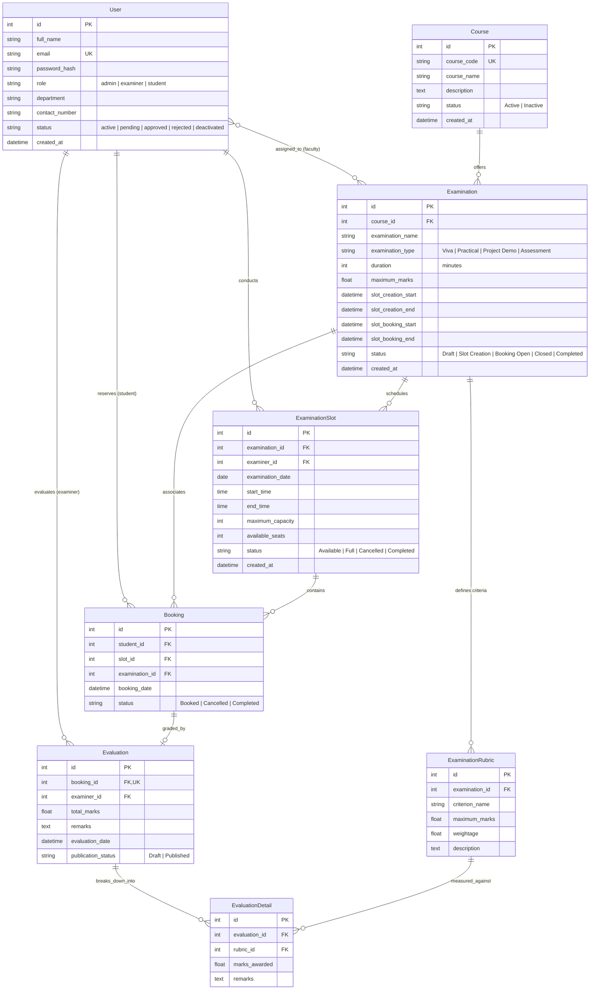

# Examination Management Portal (EMP)

An enterprise-grade, role-based academic Examination Management Portal built with **Python**, **Flask**, **Jinja2**, **Bootstrap 5**, and **SQLite**.

Developed for the **Indian Institute of Technology Madras (IIT Madras)** project curriculum to replace manual spreadsheet coordination, scheduling conflicts, and email threads with an automated, synchronized, and auditable web platform.

---

## 1. Project Overview & Objectives

In academic institutions, conducting comprehensive viva-voce examinations, lab practicals, capstone project demos, and continuous assessments often involves complex coordination across faculty examiners, academic administrators, and enrolled students. 

### Core Objectives
- **Centralize Examination Life Cycles:** Allow administrators to configure course examinations, set timelines, and assign authorized examiners.
- **Role-Based Availability Authoring:** Empower faculty examiners to author their own examination slots and capacities only during approved institutional windows.
- **Conflict-Free Candidate Booking:** Enable students to browse active examinations, inspect real-time seat availability, and book slots with zero duplicate or overlapping reservations.
- **Rubric-Based Standardized Assessment:** Standardize grading using multi-criteria weighted rubrics with score ceilings, constructive examiner remarks, and formal printable scorecards.
- **Transactional Capacity Management:** Enforce database-level and service-layer locking to prevent overbooking, handle concurrent slot claims, and restore capacity upon valid cancellations.

---

## 2. Technology Stack

Following strict project specifications, no external frontend frameworks (React, Angular, Vue, Next.js) or external database servers (PostgreSQL, MySQL, MongoDB) are used:

| Layer | Technology | Purpose |
|---|---|---|
| **Backend** | Python 3.13 / Flask 3.0 | Application factory, blueprints, WSGI routes, and business logic |
| **ORM & DB** | SQLite 3 & Flask-SQLAlchemy 3.1 | ACID transactions, relations, partial unique indexes |
| **Authentication** | Flask-Login & Werkzeug Security | PBKDF2-SHA256 password hashing, session management, RBAC |
| **Frontend** | HTML5, Jinja2, Bootstrap 5.3 | Responsive academic UI, statistic cards, modal forms |
| **Icons & Styling**| Bootstrap Icons & Custom CSS | Clean academic layout with status badge taxonomy |
| **Testing** | Pytest 9.2 | 20 automated unit and integration tests |

---

## 3. System Architecture & Folder Structure

```
examination-management-portal/
│
├── app/
│   ├── __init__.py                # Flask application factory, error handlers, Jinja filters
│   ├── extensions.py              # SQLAlchemy and LoginManager instances
│   │
│   ├── models/                    # Relational Database Models
│   │   ├── __init__.py
│   │   ├── user.py                # User model (Admin, Examiner, Student, status gate)
│   │   ├── course.py              # Academic Course model
│   │   ├── examination.py         # Examination model & examiner association table
│   │   ├── rubric.py              # ExaminationRubric criteria model
│   │   ├── slot.py                # ExaminationSlot model with seat calculation
│   │   ├── booking.py             # Booking model with partial unique index
│   │   └── evaluation.py          # Evaluation & EvaluationDetail models
│   │
│   ├── routes/                    # Modular Blueprint Controllers
│   │   ├── __init__.py
│   │   ├── auth.py                # Login, Student/Examiner registration, logout
│   │   ├── admin.py               # Courses, Exams, Rubrics, Examiners, Rescheduling
│   │   ├── examiner.py            # Assigned exams, Slot authoring, Rubric grading
│   │   ├── student.py             # Catalog search, Slot booking, Cancellation, Scorecard
│   │   └── decorators.py          # Role guards (@admin_required, @examiner_required, etc.)
│   │
│   ├── services/                  # Business Logic & Validation Engine
│   │   ├── __init__.py
│   │   ├── examination_service.py # Timeline checks, status automation, rubric ceilings
│   │   ├── booking_service.py     # Concurrency locking, duplicate guards, rescheduling
│   │   └── evaluation_service.py  # Score validation, examiner authorization, publishing
│   │
│   ├── templates/                 # Jinja2 Layouts & Views
│   │   ├── base.html              # Master layout with responsive navbar & dynamic sidebar
│   │   ├── auth/                  # login.html, register_student.html, register_examiner.html
│   │   ├── admin/                 # dashboard.html, courses.html, examinations.html, etc.
│   │   ├── examiner/              # dashboard.html, slots.html, evaluate_student.html, etc.
│   │   ├── student/               # dashboard.html, examinations.html, result_card.html, etc.
│   │   └── errors/                # 400.html, 403.html, 404.html, 500.html
│   │
│   └── static/
│       ├── css/style.css          # Custom academic styling & status badge styles
│       ├── js/                    # Client-side dynamic score aggregators
│       └── images/                # Portal icons and brand imagery
│
├── instance/
│   └── emp.db                     # Local SQLite database
│
├── tests/                         # Pytest Automated Test Suite (20 Tests)
│   ├── conftest.py                # Shared fixtures with StaticPool SQLite in-memory DB
│   ├── test_auth.py               # Authentication, registration & RBAC URL guards
│   ├── test_admin.py              # Admin CRUD, examiner approval & slot reassignment
│   ├── test_examiner.py           # Slot creation, schedule conflicts & rubric grading
│   ├── test_student.py            # Catalog browsing, slot reservation, cancellation
│   └── test_booking.py            # Overbooking prevention, duplicate check, rescheduling
│
├── scripts/
│   └── seed_database.py           # Idempotent database population script
│
├── config.py                      # Development, Testing, and Production configurations
├── run.py                         # Application entrypoint & table auto-provisioning
├── requirements.txt               # Locked Python dependencies
├── README.md                      # Comprehensive user & developer manual
├── PROJECT_REPORT.md              # 5-Page IIT Madras formatted project report
├── DEVELOPMENT_LOG.md             # Complete timeline and milestone development log
├── VIVA_PREPARATION.md            # Comprehensive viva Q&A and live coding guide
├── .gitignore                     # Git ignore rules for venv, cache, instance db
└── .env.example                   # Environment configuration template
```

---

## 4. Entity-Relationship (ER) Diagram



---

## 5. Local Setup & Execution (Windows Instructions)

Follow these steps to run the application on your local machine:

### Step 1: Open PowerShell or Command Prompt
Navigate to the project root directory:
```powershell
cd "d:\Dev_Projects\IITM Tools in DS\examination-management-portal"
```

### Step 2: Create and Activate Virtual Environment
```powershell
python -m venv .venv
.\.venv\Scripts\Activate.ps1
```

*(If PowerShell script execution is restricted, run: `Set-ExecutionPolicy -Scope Process -ExecutionPolicy Bypass`)*

### Step 3: Install Required Dependencies
```powershell
pip install -r requirements.txt
```

### Step 4: Populate Demonstration Database
Run the seed script to create all database tables and load realistic demonstration records:
```powershell
python scripts\seed_database.py
```

### Step 5: Start the Flask Application
```powershell
python run.py
```

Open your browser and navigate to:
```
http://127.0.0.1:5000
```

---

## 6. Pre-Configured Demonstration Credentials

The database seeding script configures realistic demonstration accounts for all three roles:

| Role | Email Address | Password | Account Purpose / Features |
|---|---|---|---|
| **Administrator** | `admin@emp.edu` | `AdminPassword@123` | Full portal access, approvals, course/exam creation, rescheduling |
| **Approved Examiner 1** | `examiner1@emp.edu` | `ExaminerPass@123` | Dr. Aris Thorne (Assigned to CS101, DS201; slot authoring & grading) |
| **Approved Examiner 2** | `examiner2@emp.edu` | `ExaminerPass@123` | Prof. Maya Sen (Assigned to CS101, DS201, AI301) |
| **Pending Examiner** | `examiner.pending@emp.edu` | `ExaminerPass@123` | Dr. Rajesh Kumar (Demonstrates pending approval workflow) |
| **Student 1** | `student1@emp.edu` | `StudentPass@123` | Aarav Sharma (Active booking in CS101 Slot 1) |
| **Student 2** | `student2@emp.edu` | `StudentPass@123` | Diya Patel (Completed evaluation with published scorecard) |
| **Student 3** | `student3@emp.edu` | `StudentPass@123` | Rohan Verma (Booked in Slot 2) |
| **Student 4** | `student4@emp.edu` | `StudentPass@123` | Ananya Iyer (Demonstrates preserved cancelled booking record) |
| **Student 5** | `student5@emp.edu` | `StudentPass@123` | Siddharth Nair (Unbooked student ready for fresh booking demo) |

---

## 7. Running Automated Test Suite

A complete test suite covering all critical business logic, security guards, and workflows is included in `tests/`:

```powershell
pytest tests -v
```

### Test Coverage Highlights (20 Passing Tests):
- **Authentication (`tests/test_auth.py`):** Admin login, student registration, examiner self-registration, pending approval gate, approval by administrator, role-based URL protection (HTTP 403).
- **Admin Operations (`tests/test_admin.py`):** Course CRUD, examination creation, rubric mark ceiling validation, examiner verification, and slot examiner reassignment.
- **Examiner Operations (`tests/test_examiner.py`):** Slot creation, schedule conflict prevention, candidate roster viewing, rubric evaluation submission with mark range checks, and unauthorized examiner access blocking.
- **Student Operations (`tests/test_student.py`):** Catalog search, slot reservation, real-time seat decrement, student cancellation, and published scorecard visibility.
- **Critical Business Rules (`tests/test_booking.py`):** Slot overbooking prevention, duplicate active booking prevention for the same exam, booking window deadline enforcement, slot authoring window enforcement, and admin slot rescheduling.

---

## 8. Role-Based Workflows

### A. Administrator Workflow
1. **Log in:** Access portal via `admin@emp.edu`.
2. **Review Examiners:** Navigate to **Examiners** to approve or reject pending faculty applications.
3. **Manage Syllabi:** Create or edit academic courses under **Courses**.
4. **Create Examination:** Define examination title, type, duration, maximum marks, and timelines.
5. **Configure Rubrics:** Add criteria (e.g. *Algorithm Theory*, *Code Demonstration*) ensuring criteria sum equals exam maximum marks.
6. **Assign Faculty:** Checkmark approved examiners authorized to conduct the examination.
7. **Audit & Reschedule:** Monitor student bookings in real-time, reschedule students across available slots, or reassign examiners.

### B. Examiner Workflow
1. **Register / Log in:** Register as faculty. Once approved by admin, log in via `examiner1@emp.edu`.
2. **View Assigned Exams:** Inspect assigned modules and verify active slot creation windows.
3. **Author Slots:** Define examination date, time window, and maximum seat capacity. The system prevents scheduling overlapping slots.
4. **Inspect Candidate Roster:** View students booked into your slot with their institutional contact details.
5. **Evaluate Candidate:** Enter criterion scores against configured rubrics. The dynamic interface calculates totals live and validates mark ceilings.
6. **Publish Results:** Save as draft or publish officially to release marks to the student.

### C. Student Workflow
1. **Register / Log in:** Create an account or log in via `student1@emp.edu`.
2. **Browse Catalog:** Filter available examinations by course or examination type.
3. **Book Slot:** View open slots, check remaining seats, and reserve a seat. The system prevents duplicate active bookings for the same exam.
4. **Manage Schedule:** Review upcoming slots in **My Bookings**. Cancel before the deadline if needed (seat is restored immediately to the pool).
5. **View Results:** Open **Results & Feedback** to inspect official marks, rubric breakdowns, evaluator feedback, and print verified scorecards.

---

## 9. Security & Concurrency Design

- **Password Security:** Salted PBKDF2-SHA256 password hashes generated via `werkzeug.security`.
- **Role-Based Access Control:** Decorators (`@admin_required`, `@examiner_required`, `@student_required`) protect every endpoint on the server side.
- **Approval Gate:** Inactive and pending examiners are rejected by Flask-Login's `is_active` override.
- **Database Concurrency & Row-Level Protection:** Slot reservations utilize atomic decrement and capacity validation inside database transactions to eliminate race conditions.
- **Duplicate Booking Prevention:** Enforced at both the service layer and via an SQLite partial unique index (`uq_active_student_exam_booking`) on `bookings (student_id, examination_id) WHERE status = 'Booked'`.
- **Audit Preservation:** Cancelled and completed bookings remain in the database for institutional accountability.
